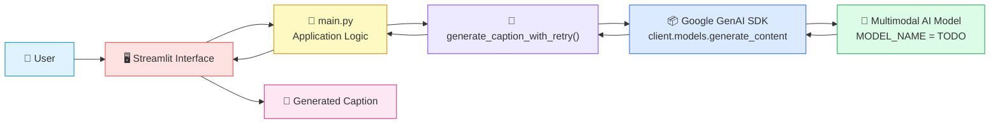
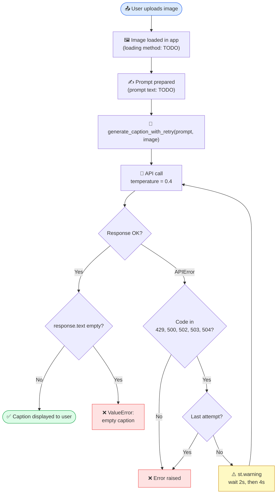
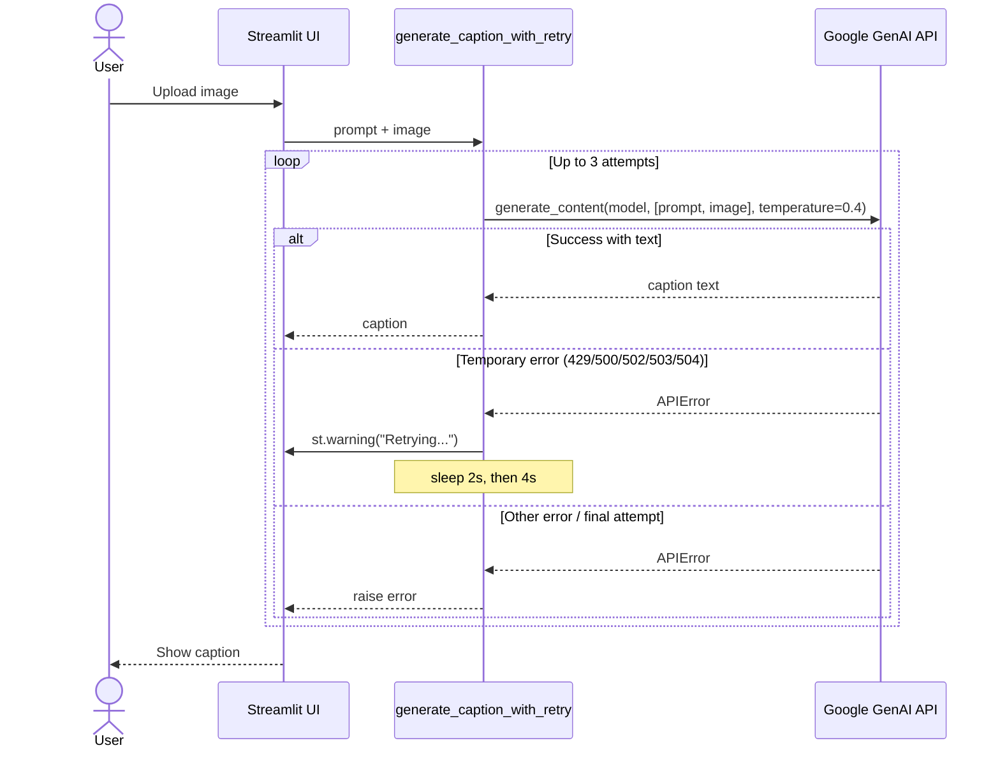
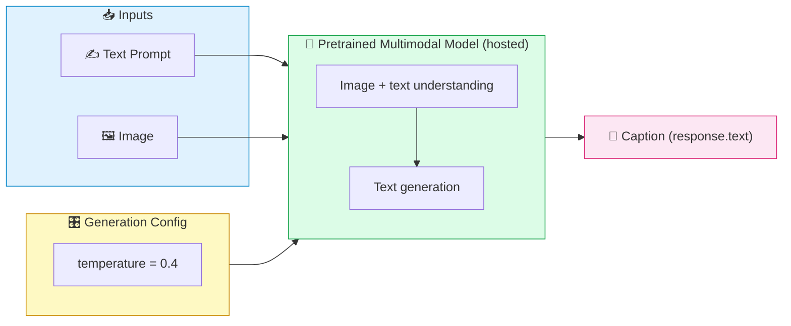

<div align="center">

# 🖼️ Image Caption Generator 🤖

### *Upload an image. Get a meaningful caption. Powered by AI.*


<!-- TODO: Replace with a banner or demo GIF -->


[🚀 Demo](#-screenshots--demo) · [⚙️ Installation](#️-installation--setup) · [🏗️ Architecture](#️-project-architecture) · [🔮 Future Work](#-future-improvements)

</div>

---

## 📖 Overview

> **Image Caption Generator** is an AI-powered web app that looks at an image you upload and writes a natural-language description of it.

It combines **Computer Vision** and **Natural Language Generation** by sending the uploaded image, along with a text prompt, to a pretrained multimodal AI model through the **Google GenAI SDK**. The user interface is built with **Streamlit**.

| 🎯 Goal | 💡 Approach | 🖥️ Interface |
|:---:|:---:|:---:|
| Turn images into meaningful text | Multimodal model called via API | Streamlit web app |

---

## ✨ Key Features

| | Feature | Description |
|:---:|---|---|
| 📤 | **Image Upload** | Upload an image through the Streamlit interface |
| 🧠 | **AI Caption Generation** | Image + prompt sent to a multimodal model to produce a caption |
| 🎛️ | **Controlled Creativity** | Generation uses `temperature=0.4` for focused, consistent captions |
| 🔁 | **Automatic Retry** | Retries up to **3 attempts** on temporary API errors (`429, 500, 502, 503, 504`) |
| ⏱️ | **Exponential Backoff** | Waits **2s, then 4s** between retries |
| ⚠️ | **Live User Feedback** | Shows a Streamlit warning while retrying |
| 🛡️ | **Empty-Response Handling** | Raises a clear error if the model returns no caption |
| 🧩 | **Extra features** | <!-- TODO: add anything else your app does (download caption, multiple styles, etc.) --> |

---

## 🛠️ Technologies & Tools

> Based on the code provided. Add any other libraries from your full project.

| Technology | Badge | Purpose |
|---|---|---|
| **Python** |  | Core language |
| **Streamlit** |  | Web UI and user warnings (`st.warning`) |
| **Google GenAI SDK** |  | `client.models.generate_content`, `types.GenerateContentConfig`, `errors.APIError` |
| **time** (stdlib) |  | Delay between retries |
| **Image library** |  | <!-- TODO: e.g. how the uploaded image is loaded --> |
| **Other** |  | <!-- TODO --> |

---

## 🏗️ Project Architecture



---

## 🔄 Workflow: From Upload to Caption



### ⏳ Request Sequence



---

## 🧠 Model Architecture & How It Works

This project does **not** train its own captioning network in the code provided. It sends the image and a text prompt to a **pretrained multimodal model** hosted behind the Google GenAI API, and the model returns the caption.



| Component | Details |
|---|---|
| **Model** | `MODEL_NAME` → <!-- TODO: add the exact model name from your code --> |
| **Inputs** | `[prompt, image]` passed together as `contents` |
| **Temperature** | `0.4` (lower values give more focused, consistent output) |
| **Output** | Text caption read from `response.text` |
| **Prompt** | <!-- TODO: paste or describe your prompt --> |
| **Internal architecture** | Managed by the model provider (not part of this repository) |

---

## ⚙️ Installation & Setup

### 1️⃣ Clone the repository

```bash
git clone https://github.com/<your-username>/<your-repo-name>.git
cd <your-repo-name>
```

### 2️⃣ Create a virtual environment *(recommended)*

```bash
python -m venv venv

# macOS / Linux
source venv/bin/activate

# Windows
venv\Scripts\activate
```

### 3️⃣ Install dependencies

```bash
pip install -r requirements.txt
```

> ⚠️ `requirements.txt` was empty in the uploaded files. Based on the code, it should include at least:
>
> ```text
> streamlit
> google-genai
> # TODO: add any other libraries your project imports (e.g. an image library)
> ```

### 4️⃣ Configure your API key

```bash
# TODO: replace with the exact method your code uses
export <API_KEY_ENV_VAR>="your_api_key_here"
```

> 🔐 Never commit your API key to GitHub. Keep it in an environment variable or a `.env` file listed in `.gitignore`.

### 5️⃣ Run the app

```bash
streamlit run main.py
```

Then open **http://localhost:8501** in your browser.

---

## 📁 Project Structure

> Only `main.py` and `requirements.txt` were provided. Update the rest to match your repo.

```text
Image-Caption-Generator/
│
├── 📄 main.py              # Streamlit app + caption generation with retry logic
├── 📄 requirements.txt     # Python dependencies
├── 📄 README.md            # Project documentation
├── 📂 assets/              # TODO: screenshots and sample images
│   ├── 🖼️ demo.png
│   └── 🖼️ sample_1.jpg
├── 📄 .env                 # TODO: API key (do NOT commit)
├── 📄 .gitignore           # TODO
└── 📄 LICENSE              # TODO
```

---

## 🖼️ Sample Input & Output

| 📥 Input Image | 📤 Generated Caption |
|:---:|:---|
|  | `TODO: paste the caption your app generated` |
|  | `TODO: paste the caption your app generated` |
|  | `TODO: paste the caption your app generated` |

---

## 📸 Screenshots & Demo

<div align="center">

| 🏠 Home Page | 📤 Image Upload |
|:---:|:---:|
|  |  |

| ✅ Caption Result | ⚠️ Retry Warning |
|:---:|:---:|
|  |  |

🎥 **Live Demo:** `TODO: add link` &nbsp;|&nbsp; 🎬 **Video Walkthrough:** `TODO: add link`

</div>

---

## 🔮 Future Improvements

- [ ] 🌐 Multi-language caption support
- [ ] 🎨 Selectable caption styles (short, detailed, creative)
- [ ] 📦 Batch caption generation for multiple images
- [ ] 💾 Download or copy captions and export to CSV/JSON
- [ ] 🔊 Text-to-speech for generated captions
- [ ] 📱 Improved mobile-friendly layout
- [ ] ☁️ Cloud deployment (e.g. Streamlit Community Cloud)
- [ ] 🧪 Automated tests for the retry logic
- [ ] ➕ `TODO: add your own ideas`

---

## 👨‍💻 Author

<div align="center">

| | |
|:---:|:---|
| 👤 **Name** | `TODO: Your Name` |
| 📧 **Email** | `TODO: your.email@example.com` |
| 💼 **LinkedIn** | `TODO: link` |
| 🐙 **GitHub** | `TODO: https://github.com/<your-username>` |

</div>

---

## 🏁 Conclusion

**Image Caption Generator** shows how modern multimodal AI can turn an uploaded image into a clear text description. A simple Streamlit interface, a low-temperature generation setting, and a retry system with exponential backoff make it reliable as well as easy to use.

<div align="center">

### ⭐ If you found this project useful, please give it a star! ⭐

*Made with ❤️ and Python*

</div>
